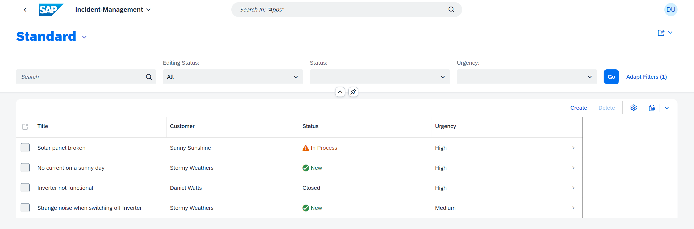
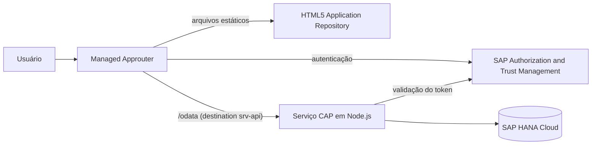
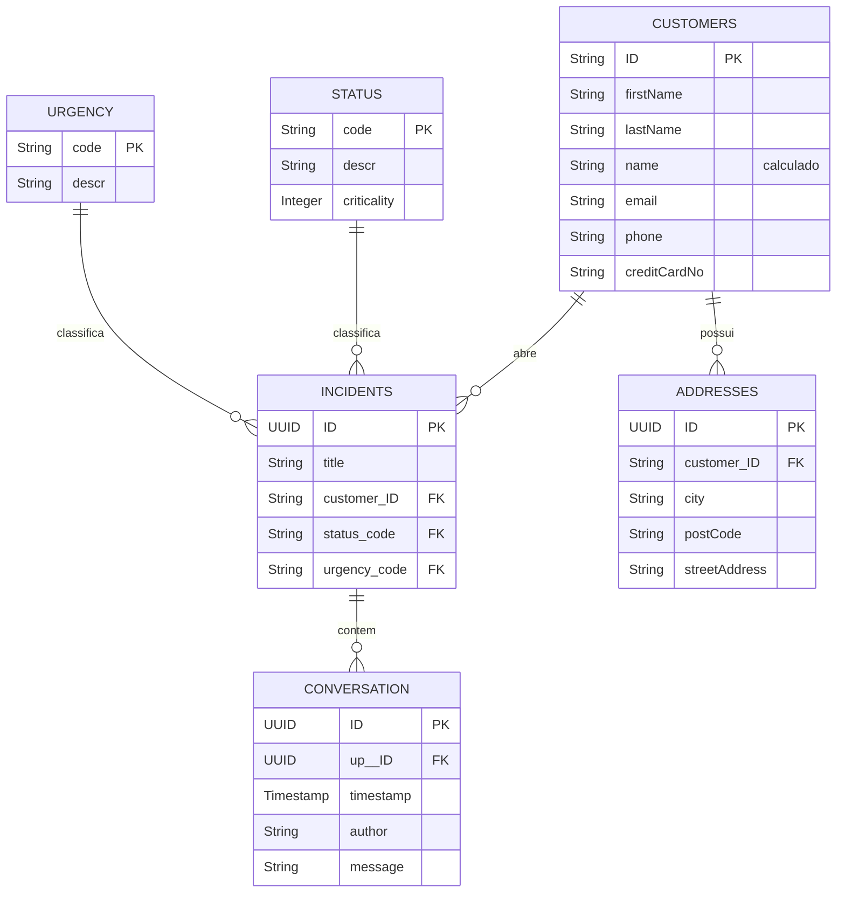

# Incident Management

Aplicação full-stack para gestão de incidentes de atendimento ao cliente, construída com **SAP Cloud Application Programming Model (CAP)** e **SAP Fiori Elements**, com deploy preparado para o **SAP BTP, Cloud Foundry**.

Projeto desenvolvido a partir da missão da SAP [Develop a Full-Stack CAP Application Following the SAP BTP Developer's Guide](https://developers.sap.com/group.cap-application-full-stack.html).




## Sumário

- [Funcionalidades](#funcionalidades)
- [Arquitetura](#arquitetura)
- [Modelo de dados](#modelo-de-dados)
- [Serviços e autorização](#serviços-e-autorização)
- [Regras de negócio](#regras-de-negócio)
- [Estrutura do projeto](#estrutura-do-projeto)
- [Execução local](#execução-local)
- [Testes](#testes)
- [Deploy no SAP BTP](#deploy-no-sap-btp)
- [Autor](#autor)

## Funcionalidades

- **List Report** com busca, filtros por status e urgência e status destacado por criticidade.
- **Object Page** com dados gerais, detalhes e histórico da conversa com o cliente, com inclusão de mensagens na própria tabela.
- **Edição em rascunho (draft)** de incidentes pelo Fiori Elements.
- **Ajuda de valores** para selecionar o cliente, exibindo nome e e-mail.
- **Urgência automática** quando o título contém a palavra "urgent".
- **Bloqueio de alterações** em incidentes encerrados.
- **Controle de acesso por papéis**: `support` e `admin`.
- **Testes automatizados** de API, fluxo de draft, regras de negócio e autorização.

## Arquitetura



| Camada | Tecnologia |
|---|---|
| Interface | SAP Fiori Elements (List Report e Object Page), SAPUI5 1.154, tema `sap_horizon` |
| Serviços | SAP CAP 10 em Node.js, OData V4 |
| Banco de dados | SQLite em desenvolvimento, SAP HANA Cloud (HDI) em produção |
| Autenticação | Usuários mockados em desenvolvimento, XSUAA em produção |
| Deploy | Multi-Target Application (MTA) no SAP BTP, Cloud Foundry |
| Testes | `@cap-js/cds-test` com o test runner nativo do Node.js |

## Modelo de dados

O modelo está em [`db/schema.cds`](db/schema.cds), no namespace `sap.capire.incidents`.



Listas de códigos:

| Status | Descrição | Criticidade |
|---|---|---|
| `N` (padrão) | New | 3 |
| `A` | Assigned | 2 |
| `I` | In Process | 2 |
| `H` | On Hold | 3 |
| `R` | Resolved | 2 |
| `C` | Closed | 4 |

| Urgência | Descrição |
|---|---|
| `H` | High |
| `M` (padrão) | Medium |
| `L` | Low |

Os dados de exemplo ficam em [`db/data/`](db/data) e incluem 3 clientes e 4 incidentes.

## Serviços e autorização

| Serviço | Caminho | Papel exigido | Acesso |
|---|---|---|---|
| `ProcessorService` | `/odata/v4/processor` | `support` | `Incidents` com draft e `Customers` somente leitura. É o serviço consumido pela aplicação Fiori. |
| `AdminService` | `/odata/v4/admin` | `admin` | Leitura e escrita em `Customers` e `Incidents`. |

Os papéis são independentes: `support` não acessa o `AdminService`, e `admin` não acessa o `ProcessorService`.

## Regras de negócio

As regras estão em [`srv/services.js`](srv/services.js) e valem apenas para o `ProcessorService`.

| Regra | Evento | Comportamento |
|---|---|---|
| Urgência automática | `CREATE` e `UPDATE` em `Incidents` | Se o título contém "urgent", sem diferenciar maiúsculas de minúsculas, a urgência passa para `H`. Em incidentes criados pelo Fiori, a regra é aplicada ao salvar o rascunho. |
| Incidente encerrado | `UPDATE` em `Incidents` | Se o status atual é `C`, a alteração é rejeitada com a mensagem `Can't modify a closed incident!`. |

## Estrutura do projeto

```text
incident-management/
├── app/
│   ├── incidents/          # Aplicação Fiori Elements
│   │   ├── annotations.cds # Anotações de UI
│   │   ├── webapp/         # Manifest, i18n e testes OPA gerados
│   │   ├── ui5.yaml
│   │   └── xs-app.json     # Rotas do approuter
│   ├── launchpage.html     # Launchpad sandbox para desenvolvimento
│   └── services.cds
├── db/
│   ├── schema.cds          # Modelo de dados
│   └── data/               # Dados de exemplo (CSV)
├── srv/
│   ├── services.cds        # Definição dos serviços
│   └── services.js         # Regras de negócio
├── test/
│   └── test.cjs            # Testes de API
├── mta.yaml                # Descritor de deploy
├── xs-security.json        # Escopos e role templates
└── package.json
```

## Execução local

**Pré-requisitos:** Node.js 22.12 ou superior e acesso à internet, pois o launchpad local carrega o SAPUI5 a partir de `ui5.sap.com`.

```bash
git clone https://github.com/JoaoFerrareis02/incident-management.git
cd incident-management
npm ci
npm run watch-incidents
```

A aplicação abre em <http://localhost:4004/launchpage.html#Shell-home>. Os dados ficam em um SQLite em memória e voltam ao estado inicial sempre que o servidor reinicia.

Usuários de desenvolvimento, com senha em branco:

| Usuário | Papel | Uso |
|---|---|---|
| `alice` | `support` | Acessa a aplicação Fiori e o `ProcessorService` |
| `bob` | `admin` | Acessa o `AdminService` |

Para testar a API diretamente:

```bash
curl -u alice: "http://localhost:4004/odata/v4/processor/Incidents?\$filter=IsActiveEntity%20eq%20true"
curl -u bob: "http://localhost:4004/odata/v4/admin/Customers"
```

## Testes

```bash
npm test
```

A suíte tem 20 testes:

| Grupo | Testes | O que valida |
|---|---|---|
| Endpoints GET | 3 | Leitura de incidentes e clientes e uso de `$expand` |
| Fluxo de draft | 12 | Criação, ativação, encerramento, bloqueio de reabertura e exclusão |
| Urgência automática | 3 | Títulos com e sem "urgent", em maiúsculas e no meio do texto |
| Autorização | 2 | Bloqueio de `alice` no `AdminService` e acesso de `bob` |

> O script `npm test` define a variável de ambiente na sintaxe de Linux e macOS. No Windows, execute-o pelo Git Bash ou WSL.

## Deploy no SAP BTP

**Pré-requisitos:**

- Subaccount com Cloud Foundry habilitado e uma instância do SAP HANA Cloud.
- Entitlements dos serviços usados no `mta.yaml`:

  | Serviço | Plano |
  |---|---|
  | Authorization and Trust Management (`xsuaa`) | `application` |
  | SAP HANA Schemas & HDI Containers (`hana`) | `hdi-shared` |
  | Destination (`destination`) | `lite` |
  | HTML5 Application Repository (`html5-apps-repo`) | `app-host` |

- [Cloud Foundry CLI](https://docs.cloudfoundry.org/cf-cli/) com o plugin `multiapps`.
- [Cloud MTA Build Tool](https://sap.github.io/cloud-mta-build-tool/) (`mbt`).

**Build e deploy:**

```bash
mbt build
cf login
cf deploy mta_archives/incident-management_1.0.0.mtar
```

**Depois do deploy:** atribua ao usuário, no BTP Cockpit, as role collections criadas:

- `support (incident-management <org>-<space>)`
- `admin (incident-management <org>-<space>)`

A aplicação usa o serviço `incidentmanagement.service` (`sap.cloud.service`) e fica disponível para ser exposta pelo SAP Build Work Zone. A configuração do site não faz parte deste repositório.

> Os CSVs de `db/data/` também são implantados no HANA. Remova-os ou mova-os para outra pasta se o ambiente não deve receber dados de exemplo.

## Autor

**João Victor Ferrareis Ribeiro**

[LinkedIn](https://www.linkedin.com/in/joao-victor-ferrareis/) · [GitHub](https://github.com/JoaoFerrareis02)